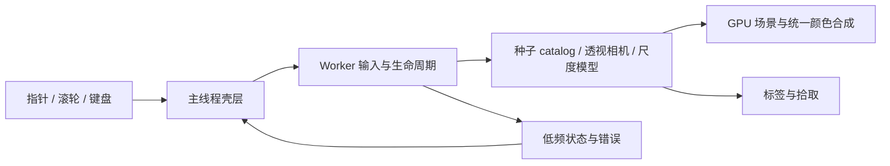

# Universe OS 设计边界

当前交付面是根目录 `index.html` 启动的宇宙观测台。`old/` 是历史原型，不参与当前运行或验证。本文记录稳定行为与证据；具体纹理、颜色、亮度、相机参数和中文/英文文案属于可迭代的表现选择。

## 目标与所有权

在克制的界面中，用明确的空间层次和连续运动呈现从银河到天体近景的尺度旅行。用户接近同一天体时，银河结构、星际空间、远方天幕和天体细节共同演化，并能连续返回星图。

| 边界 | 稳定声明 |
| --- | --- |
| 页面壳层 | 主线程负责能力检查、可访问界面、语言选择、输入转发和低频状态。恒星数量不改变 DOM 规模。 |
| 场景 | Dedicated Worker 拥有 catalog、相机、绘制、标签布局和拾取。WebGPU 与 OffscreenCanvas 缺失时明确说明无法进入场景。 |
| Catalog | 同一目标的远处表示、近景、标签、拾取和焦点共享稳定身份。生成内容由种子确定，目录位置与数据不随活动被改写；银河中的天体与环境共享派生的空间运动，有限太阳系成员叠加同帧轨道姿态。辅助尘埃与外围晕层星光不成为可选恒星。 |
| 相机 | 星图、远天幕、表面、标签与拾取使用同一透视镜头。滚轮改变距离目标，相机连续追随；观察相机围绕当前主体或显式选择的主体内部区域，内部区域保留所属天体身份；缩放仅改变距离，镜头平移跟随移动主体，朝向与视场不随距离隐式改变，继续接近仍放大表面直到几何边界。远天幕提供稳定角度参照，不随接近另行扩大或收缩视场。阅读时投影适应资料及共同观察控制之外的区域，容纳整体观测的主体与环带，显式局部地貌近观允许主体超出观察区；同一阅读布局仍使用固定视场，世界姿态、距离与目标不变。窄屏资料保留独立的观察空间，标题与收起入口持续可见，正文、来源与相关操作可滚动或键盘到达；阅读滚动不改变观察区或镜头，窗口变化后正在阅读的焦点仍可见。明确的尺度端点操作抵达对应距离，不能只改变控件显示值。 |
| 近景主体 | 观察位置拥有唯一高细节三维主体，恒星、行星、卫星、彗星、脉冲星、黑洞、星云与星系共享身份、镜头和交接。静止观察时与所选目标一致；近景切换时先退离原主体，再将同一绘制资源交给目的地。不透明部分的轮廓与拾取一致，透明部分使用有深度的结构；观察角度改变可见特征。整体观测保留可辨认的大结构，继续接近渐进呈现较细的地形、云系或物质结构；两档细节共享位置、主体形状与时钟，不能通过替换身份或变换镜头制造细节。细纹和轮廓按实际绘制分辨率过滤，不以不可分辨的纹理增加近景成本。紧致核心的覆盖与透明发光层共用几何轮廓，近景交界在有限像素范围内保留前景物质与后方光的区别，不能用粗体积重建制造台阶或发光漏边。有限的邻近行星与卫星在固定点预算内共享主体的表面、倾角、受光和环带；可见尺寸与实际绘制分辨率决定细节，是否选中不改变云系或地貌。有限实体的合成顺序依据共同空间的实际遮挡关系，所选主体不能固定盖住前景邻体；中心被遮挡的名称隐藏；实体中心出屏时，只要不透明边缘仍可见，就继续参与遮挡、最近表面拾取和绘制顺序。倾斜环带和细长形体使用同一外包络做保守候选，实际射线决定是否命中，空隙与透明延展不能成为实体点击范围。名称避免覆盖另一前景实体，空间允许时移到邻近空处，不能形成穿过实体的点击岛。透明体积保持独立观察边界。邻体仍作为可访问的空间参照，不扩展透明体积资源。 |
| 环境 | 银河辐射与暗尘、远天球、稀薄局部粒子共同提供空间参照，随尺度连续演化。内部全景保留原有角度参照和暗尘结构，抑制与实时星场重复的孤立亮峰，不能靠放大模糊背景星点表达浩瀚。银河气体具有可环视的厚度与非均匀结构，暗尘按前后位置共同衰减气体和星光；局部活动服从观测时钟。近景形成主体活动、可访问邻体与远景的主次，局部运动线索不遮掩主体。辅助内容不拥有 catalog 身份、标签或拾取入口；银河气体、尘埃与可选天体共享同一空间变换；外围旋臂碎散为不同方向的延伸星群、气体和较厚晕层，辐射和星光渐淡，不以共同截断的亮边表达资源范围；外围星光与气体共用有限的世界空间结构和碎散密度，沿连续而不对称的弯曲旋臂延伸，外层星流具有不同的伸展方向、厚度与衰减距离，不合围成共同外弧；从中央到外围的中间空间保留参照，不以独立团块代替连接；连接星光、云气和暗尘共享相互覆盖、方向不同且向外增厚的碎散空间层，使中央与外围之间保留非平面的参照；长气柱的碎散密度服从实际跨越范围与绘制分辨率，不把局部变化投影为随视角滑动的条带；气体前景只衰减其后的星光，不能用共同亮边或均匀雾球替代层次；弯曲外层的前景尘埃按到被观察星光的距离衰减，不让光点被它后方的整段外层气体统一抹去；外部到内部的变化保持同一目标锚点与用户镜头。内侧目录和原尘光在资源范围内渐淡，外围没有共同的圆形截断。外围内容提供随视角变化的空间深度。中央恒星棒与立体隆起、较厚的恒星层和稀疏恒星晕保留与薄气尘盘不同的高度分布；辅助星光与连续发光层共享空间，云团沿高度也有不同结构。侧视、盘下方及进入旋臂时应有前后关系，不能通过统一放大整个盘的厚度替代分层。恒星隆起的遮光依据到发光位置的前景物质，不把盘内整段尘埃统一盖在隆起前方。增强高度与亮度属于艺术表达，不改变目录位置，也不表现不可见暗物质为发光雾。连续恒星光与气体各自保留空间归属，不能用重复叠加的大范围未消光亮层抹平外围深度；未分辨光点按实际绘制像素过滤并保留解析光能归一化，有限绘制范围仍可裁去外翼，远星系的艺术化光色响应依据可分辨尺寸，远处体积、近处体积与内部光点共同渐变，不改变身份、几何、消光或拾取。固定远星群在接近和退离时保留角度参照，画质改变只增加同一空间中的样本；辅助点仍受固定预算约束，延伸气体不增加体积步数。远天球与外部星系提供独立参照；银河内部全景按观察者的实际位置渐变，不在银河外复制为全天背景。远处未分辨恒星逐渐以连续星光与较少的可辨认亮点共同呈现，聚合光与点光使用同一银河空间和前景消光，不改变恒星身份或近观光球；外部亮点与有厚度的真实星系共同提供参照，辅助背景仍有固定预算且明确为程序表达，目录身份保持不变。 |
| 合成 | 恒星、尘埃和光晕在 GPU 场景中合成并统一映射到显示颜色，保留明亮表面的可见变化；发光核心与盘面的亮区须保有局部层次，不能用整片白色覆盖可探索结构。透明体积可在有限的独立分辨率中绘制后合成，维持同一投影、透明度与身份；实体表面和可选天体不随之降低分辨率。实时 2D canvas 只负责有限地图注记；按需生成的观测图属于独立输出。 |
| 预算 | 同屏天体点、尘埃、天空点、局部粒子、标签和拾取有固定上限；远天球、行星底图纹理及其 mip 层是有限档位内的固定资源，透明体积采样与星系局部星光具有固定上限。新档位资源准备后统一替换并释放原纹理与绘制目标；失败保持原视图并有反馈。增加 catalog 不线性增加绘制或主线程工作；不为每颗恒星创建 mesh、material 或 DOM。 |
| 失败 | 初始化、绘制设备和能力失败须变成可见状态；不能留下永久加载或静默黑屏。 |

星系的连续恒星光与有限内部光点共享艺术化的恒星光色，暗尘保留前景消光，局部气体与恒星发光分开；普通星系以恒星总体和尘带为主，强风区可保留明确气体表达。远处与近处采用同一发光语义，不能用随机粉红星点代替气体区域；配色和亮度不作为实测光谱或真实测光。

星云是可选的延展天体，使用固定预算的体积观察路径。近处气尘的明暗方向来自同一空间中已有的艺术化光源，外部照亮的云体保留外侧漫射方向；局部照明只调制气体发光，不修改密度、相机消光、内部星光的前景尘柱或光点身份。光源方向邻位与可见气体共享形态、时钟、两档细节及采样范围，无新增表面或可选天体。它没有固体表面；用户可以从远处辨认、抵达外部，再继续进入云的范围、环视并退离。首次进入依据当前云体的范围和既有最近观察限制，不能因最近距离较大而再次停在外部；镜头朝向与目标身份保持不变。近景的气结、短尾和断续云丝保留三维位置，环视可见不同的云岸与空腔；细节按实际采样范围过滤，不以均匀放射纹代替气体层次。程序化气体、暗尘与核心星光属于该星云的艺术化观察线索，不制造独立命名身份或测量数据。环状星云以主环、内侧气体与丝状内缘提供与恒星诞生云不同的观察内容；中央残骸亮点仍属同一透明目标，不增加实体拾取或独立目录身份。螺旋星云以疏松壳层与彗星状气结提供不同的观察内容，气结不是独立彗星；礁湖星云以暗尘通道、云岸与受照空腔形成不同于对称壳层的空间。星云的气体、暗尘、嵌入亮点和抵达视角共享目录的空间变换，进入时间不能另行改变结构与推荐朝向的关系。嵌入亮点只被观察者到自身位置之间的气尘衰减，前景光源不受后方云体遮暗，浓尘也不保留固定可见下限；气体与亮点共用同一有限积分，不能另加独立遮罩或第二套体积。未分辨的嵌入亮点按视角和实际绘制像素过滤，近距离经过不能因固定世界尺寸的光晕膨胀成遮住云体的白斑。新增延展目标以开放双瓣、交叠壳层、尘腰双极云翼、偏心风泡、破碎诞生云环、超新星冲击丝、分支暗尘与受侵蚀云脊提供不同的内部探索；不能将这些形态简化为换色球云。反射云岸、三向暗尘通道、风壳肋带、多空腔云桥、外部受照云缘、锥状尘柱和梯带双极外流进一步提供不同的空间关系；银河系外恒星形成区在资料与保存图中保留实际所属星系，压缩位置不冒充测量布局。被尘埃隐藏的中央星及未有依据的残骸中央星不以可见亮点冒充观测事实。各目标仍共享固定体积资源、连续细节与发现、环视、保存、对照、回访和返航路径。云内采样可将有限工作更多分配给眼前的云壁，仍覆盖完整可见射线；采样宽度与绘制分辨率共同过滤薄层和细纹。共享程序噪声可以使用有固定内存上限的平滑周期三维缓存，不能随目标或画质复制；空间场应跨方向连续，不能让插值格点在云岸中形成共同的方格断口；近景细纹与宏观云体共享位置和时钟，质量切换复用缓存，销毁释放。科学来源与程序壳层、颜色、密度和活动明确分开。透明区域保持天幕可见，也不能使用球体遮挡规则抹去背景目标；标签避开主要云体而保持位置参照。进入、停止、切换和返航服从同一镜头与观察身份边界，减少动态停用气体的自动变化。

冥王星以独立矮行星类别发现，卡戎保持其卫星关系；两者共享普通实体的两档细节、拾取、家族及往返边界，不改变八大行星分类。新视野号历史镶嵌图的分辨率与覆盖不均，缺测范围使用明确说明的平坦中性色，不推测地貌；增强受光不是高程测量，围绕所属天体的示意轨道不是质心星历。资料与保存图同时标明实际底图归属。

恒星 catalog 的既有身份、种子和 `catalog` 数量语义保持兼容；有来源的有限恒星残骸可使用保留身份共用总点预算，而不占用或重编号生成恒星。天狼星 B、南河三 B 与范马南星为独立恒星目标，以紧凑的淡色热区、连续弯曲热边界及克制光晕区别于普通恒星；温度色彩为作者设计而非测量，不复用太阳式日冕弧。南河三主星在单体与共同视角中共用暖色活动光球，不能因选择身份更换表面。天狼星与南河三的主伴星共同视角、互访、保存、回访与返回沿用有限家族边界，并保持太阳系成员语义；其他家族从相关天体资料进入。共同观察的显示轨道可从原目录与天体尺寸压缩派生，让主星与较小伴星有可辨认的发光外观；其球面、位置、表面坐标和时钟在单体与邻体之间一致，亮点到球面交接不应使小伴星消失。完整示意轨道仍纳入入场范围，静止时不追随伴星缩放或转向；目录位置和太阳系家族保持原有语义。相对尺寸、间距、淡色表面、活动与围绕主星的公转明确为程序示意，不是表面测量、真实比例或质心星历；实体球面仍是唯一遮挡和拾取范围。有限的太阳系行星拥有独立且稳定的身份，与恒星共用总点绘制预算和标签预算。行星不自发光：远处亮点与近景球面使用同帧所属恒星方向，观察角度可揭示明暗变化；未分辨的反射体及弥散星云按投影覆盖面积渐弱，不能在退远后堆成固定大小的发光团。有限远处天体与星光共享到自身位置为止的前景银河消光；难以分辨的普通场景目标不留下空白点击区，明确的家族示意标记与命名导航仍可达。地形调制受光区域，不制造暗面光斑。太阳方向驱动昼夜，水星使用有归属、经色彩增强和缺测填补的数据衍生地图，资料与保存图标明作者、许可和缩小处理；地球底图与云系来自有归属的历史观测合成图；火星使用有归属、经过增强和缺测填补的 NASA 数据衍生地图，资料明确区分科学来源与底图来源。薄云层共享天体身份与受光几何，云层移动、阴影、大气、土星条带和环带为艺术化表达，不提供实时天气。岩石荒漠不复用地球的海洋反光或云层。无观测底图的行星使用明确说明的程序地形或云顶：金星不透明厚云、冰巨行星的浅云带与风暴不宣称测量重建或当前天气；窄环与透明间隙保持相同绘制和拾取范围。岩质与冰质近景的起伏受光按地图覆盖、球面位置和实际分辨率过滤，极区与缺测边界不放大伪起伏；地貌先于装饰微粒，接近和环视仍保留同一底图。底图衍生的地形增强与海洋微波反光同样属于受光示意，不更改科学地图归属。气态巨行星以云顶、条带和风暴形成可辨认的观察内容，不制造固体着陆语义；有归属的历史云顶地图与模拟风、旋转和光照分开。云岸受光与细流来自同一球面上的连续结构，近景在保留宽风带、风暴和极区的基础上渐进增加细节；云顶受光不是固体地形或测量高度。不同的大气世界共用按实际局部投影过滤的连续云岸，较细云流附着于同一云岸与旋涡，而非重复块状斑纹或独立颗粒层；流场只改变云图坐标，受光仍保留原球面和有限云岸起伏。厚霾、低密度世界、暖色热窗与较强风暴保留不同对比层级，不能全部替换成同一种高反差云顶。多边形极区、极地云帽、增强的云纹和霾层单独提供观测依据，并明确为程序表达而非当前天气、自然色重建或原始观测图像。透明霾层围绕同一不透明主体，不扩展实体遮挡、拾取或目录身份。环带与球体共享主体身份，并按几何前后关系遮挡和拾取；近景不能将环带解释为独立天体。不同类别之间仍先退离再抵达，可停止、继续和返回。

系外行星沿用行星发现类别、稳定身份、两档细节与有限家族互访。紧凑凌星家族可从共同视角逐一近观岩质与云层的可能外观，再比较同伴并返回；目录别名保留发现名称与常用系统名称的对应关系，不以作者选定的材质推断已测成分。云幕、云岸与较深热窗在同一流场中形成主次，局部细纹按实际分辨率与掠视角加入；流场改变纹理坐标，不替换球面受光法线。周尘盘保留反射光、前后遮挡与实体拾取空隙，细纹同样按盘面压缩尺度过滤。年轻巨行星的热云窗口、形成中行星的周尘盘、低密度世界的宽云霾提供不同观察内容；热色与盘流为艺术解释，直接成像不等于详细云图，未测半径不能伪装成实测尺寸。新家族可共同观察、逐一接近、比较、回访与返回主星，共享既有照明、拾取和固定绘制资源。高温岩质世界的熔融区、冷却壳层与暗色玄武岩，大气世界的卷曲云岸、厚霾、超热辐射与亚海王星云幕提供不同的近观内容；整体结构与较细纹理共享物体坐标与实际分辨率过滤。内禀热辐射的作者表达不再乘上反射光颜色，玄武岩仍只反射所属恒星。光谱和相位曲线支持的广义发现与虚构的详细表面、大气地理和活动明确分开。无观测底图的岩冰世界以同一物体坐标中的宽地貌、有限盆地及可分辨的较小坡地形成近观内容；冰层裂带同属该连续地貌，不能以绘制噪声等值线冒充地形。起伏受光仍为作者示意，不改变球面或既有网格的轮廓、遮挡和拾取，内向坑壁保留真实形体的法线与直射遮光。太阳系的八大行星集合和太阳系导航保持原有语义；新增有限主星不占用或重编号生成恒星。比邻星 b、TRAPPIST-1 的七颗行星与飞马座 51 b 按各自主星的当帧方向受光，所属恒星的颜色为艺术化照明而非实测光谱；可能新增的卫星沿祖先关系继承恒星光。整体、近景、邻体和恢复受光的操作保持同一照明关系。未知表面以独立程序岩质、霜区或热气态云层表达，不复用太阳系观测地图冒充测量；霜、岩石、颜色、大气、尺寸、间距、旋转和周期明确为示意，不能据宜居带宣称水或生命。家族可以共同观察、逐一近观、比较、保存并返回；轨道不扩展太阳系成员。照明数据共享固定容量资源，画质替换复用，销毁释放，不随恒星目录增加每颗资源。

新增外侧矮行星、卫星与小行星沿用有限家族、反射光、两档细节及实体拾取。缺少可用实测底图时，表面、撞击坑、霜区、碎石与形状近似明确标为程序示意；不得与已有观测底图混为测量重建，也不占用缺测地图的中性区域。新增星云以暗尘柱、剪影、云崖和残骸丝网区分形态，仍共享固定透明体积资源与返回路径。

彗星拥有独立稳定身份与太阳所属关系。不透明彗核与透明彗发、尘尾和离子尾共用身份；尾迹不能成为不透明拾取范围或抹去背景目标，彗核轮廓必须同时用于绘制、遮挡和拾取。近景以宽地貌、坑缘和局部层理呈现彗核，细小粗糙度渐进加入；保留稀薄外层与可辨认的彗核表面喷流，不用宽亮雾替代细节；双尾以太阳方向提供空间关系，程序生成的彗核、喷流和压缩尾迹不是航天器测量模型或当前轨道。首次抵达可停在看清延展结构的位置；四颗彗星均可继续进入局部核体并一键退回完整彗核，最近距离遵守既有不透明外包络。入口语义与行星地貌、云层区分，局部观察的可用性不依赖受光面建议。近景纹理基于实际表面位置，细粒按距离和分辨率渐进加入；活动区背景属于艺术示意，不宣称实测喷口。近景尺度仍可继续抵达实体，缩放不隐式改变朝向；环视、停止、太阳往返、会话回访与本地观测图复用已有路径。透明部分沿用固定预算体积合成，实体保持独立分辨率；减少动态停用自动气体变化。

脉冲星是可分类发现的致密恒星残骸，拥有独立稳定身份。实体核心与透明辐射束、风纹共同呈现同一观察中心；只有核心提供不透明遮挡和实体拾取，周围示意结构不制造附加目标。固定镜头下，局部风纹与亮结形成、向外传播并消退，辐射束扫过空间；核心呈现平滑的自发光冷热层与磁极周围连续的温度过渡，避免以岩质或云层底图表达致密残骸；磁极与辐射束的方向一致；具有独立风区喷流的目标同时保留随磁极转动的扫束，不能用沿自转轴的喷流代替磁极辐射；附近弯曲磁场示意随主体转动，保留核心轮廓与前后遮挡关系。首次抵达可观察整体，再继续靠近核心、环视、对照并返航。核心、磁极与风区共享所属空间的当帧变换，透明结构与实体不能在银河运动中错开方向。穿过风区时，镜头附近的透明贡献连续淡出，保持核心与空间参照可辨认，不以整片亮雾突然盖住视野。真实旋转、磁极辐射与风纹观测使用科学来源；可见结构、磁场曲线、温度色彩、压缩尺度与放慢的活动明确为程序示意，不作为真实脉冲计时、表面测量或观测重建。船帆座脉冲星以双弧风区与沿自转轴弯曲的喷流提供可比较的不同结构，磁极辐射与风区喷流分别说明；喷流形态变化及可能进动的观测解释不能被示意动画当成测量结论。PSR B1509-58 提供较淡的内风弧与喷流，观察范围不冒充整片手形星云；杰明加以压缩的两侧延展结构对照风环，观测喷流几何仍为解释。各核心的热极、平滑冷热层与近景温度细变保留同一磁极球面坐标，冷热层、热极与近景变化形成主次，不用硬边噪声等值线、重复颗粒或云纹代替温度结构。风区各前后区段在所属空间中独立取样，避免合并后产生随视角滑动的虚构纹理位置；稀薄发光与遮光分别受限，前景风纹仍可发光，核心轮廓与热极保持可辨。细小温度变化根据表面实际采样与掠视角过滤，磁场示意在近景保留窄而可辨认的路径；靠近镜头的透明辐射连续淡出，不遮没核心。所有活动沿用可暂停与恢复的观测时钟，减少动态冻结；透明与实体分别沿用现有有限绘制路径，不增加独立纹理或每目标资源。

黑洞是可分类发现的独立天体。暗影与透明吸积盘、光环共用观察中心；仅暗影的几何范围遮挡和拾取，发光结构不成为实体或独立目标。倾斜、正面与侧面均有可观察内容，盘面流纹、暗隙、内侧示意热层与弯曲光弧呈现连贯的物质结构与明暗层次；活动可在固定镜头下追踪，环绕盘面不产生材质接缝，长时间观察不累积不可分辨的细纹，各档保留可辨认的结构，细节精度服从绘制预算。近档启用范围须匹配盘面外的实际导航端点，不能套用固体表面的距离条件而使细流始终不可达。继续接近仍使用固定镜头；阅读须容纳延展盘面。环视、停止、暂停活动、对照、回访、观测图与返航沿用既有路径。天体归属与黑洞结构有各自科学来源；明亮盘面、颜色、尺度、弯曲光弧与放慢的流动明确为艺术化示意，不作为观测图像、测量的吸积活动或相对论计算，不提供穿越事件视界或固体着陆语义。银河系内黑洞的盘轴与抵达视角共享目录的当帧空间变换，外部黑洞保留独立参照。M87* 的压缩长喷流、亮结与盘面共享轴向和暗影遮挡；从整体到近景保留盘面与喷流的关系，最近距离可只见喷流根部。科学资料明确实际喷流与视界光环的巨大尺度差异，以及压缩、颜色和活动的程序表达。天鹅座 X-1 与 MAXI J1820+070 提供恒星质量黑洞的对照；前者交代供给物质的伴星在近景之外，后者喷流仅受历史爆发启发，不宣称当前活动。宽流束、暗通道、内侧热层与近景细流查询同一周期闭合的空间场；大流束保留连续结构，细节按实际透明绘制分辨率渐进加入和过滤，不能以均匀碎亮取代明暗层次。直视盘面与弯曲光像共享同一盘流；角向亮结与径向细丝分别按其可分辨尺度过滤，径向压缩不能抹掉仍可看清的角向结构。宽流区、亮结与细丝保持主次，不以截白宽带或均匀细纹替代层次。示意差动剪切有界，长时间观察不能积累无限细纹。实体与透明结构复用有限绘制资源，减少动态冻结活动。

观测动态拥有独立于镜头导航的艺术化时钟。用户可暂停、恢复和有限加速天体转动、彗尾活动、星系结构、气体变化和有限太阳系成员的轨道运动，不改变目标身份、局部构图、镜头朝向、缩放距离或绘制预算；暂停后仍可导航。恢复延续原相位，不重放进入场景的亮度反馈；预览和实时减少动态偏好冻结自动活动；偏好解除后恢复用户所选节奏。实体的当帧位置与姿态同时用于绘制、光照、遮挡、标签和拾取。观察镜头平移跟随所选主体，飞行的出发与目的地各自跟随；已有显式抵达构图随当帧父体方向派生，保留地月等空间参照，回访仍采用用户记录的朝向；停止导航保留对当前主体的观察偏移。显式抵达、近邻切换与返航使用当帧父体范围避开直线路径中的母星或环带，先在当前主体周围退离，再于共同空间交接并接近；推荐或回访的观察方向仍在抵达时恢复。父体姿态只参与主动导航，不在停留或手动缩放时改变方向。明确属于银河外的目标保持银河外参照，不随银河整体空间变换转动；其局部艺术活动仍服从同一时钟。银河恒星、气体、尘埃和有限成员的位置、标签与拾取使用同一时钟与空间变换，观察镜头平移跟随主体而保持用户方向；星系局部星光与盘面也共享空间变换。控制明确区分模拟节奏与真实天文时间，只在当前会话生效。

有限家族的轨道示意从不变的目录数据派生：太阳系行星围绕太阳，系外行星围绕所属恒星，月球同时跟随地球与自己的路径，彗星呈现倾斜的逆行椭圆。海卫一保留逆行方向。在已有外侧卫星范围内，可展开过度压缩的内侧示意轨道，为母星或环带留下可辨认的观察空间；保持卫星的径向顺序、轨道方向、身份、表面与外侧包络，不把场景间距解释为真实比例。路径、尺度、初始相位与周期均服务观察，不提供实时星历、真实速度比例或当前天象。家族总览容纳轨道与银河共同运动的完整范围，不在闲置时自动缩放或扭转镜头；可显式进入行星与其卫星的局部共同空间，入场从当帧太阳方向选择可辨认受光与轨道纵深的构图，带环中心避免边缘入场；抵达后由用户控制朝向，不持续追光。镜头平移跟随局部中心，容纳成员相对中心的完整路径而不包含中心在更大系统中的轨道；轨道注记只是有限空间参照，没有独立身份或拾取入口。追踪移动成员、暂停、环视、继续接近、切换、回访、保存和返回家族使用同一位置边界，资源与注记规模不随恒星 catalog 增长。

内太阳系共同视角展开太阳、内侧行星及其已收录卫星，沿用同一目录身份、太阳中心、当帧轨道与固定镜头；只缩小观察范围，不创造另一套位置或真实尺度。完整轨道范围须在活动与不同窗口下保持可达，停留不自动转向或重拟合。总览和单体均有显式入口，近观后可返回内侧世界或完整太阳系；双语言、键盘、停止/恢复、减少动态及观测图身份使用同一语义。

自然卫星拥有独立稳定身份和所属天体关系。关系入口使用已有聚焦路径，可在行星与其卫星之间往返；月球近景提供地球参照，镜头推荐构图仍可被停止、环视和缩放中断。所属关系表达真实类型，距离、姿态和光照不作为实时轨道演算。月球使用有归属的观测底图与地形线索，受光呈现明暗交界；地形增强属于艺术化表达，不制造大气、云层或自发光语义。

火星的两颗岩质卫星采用有归属的 Viking 历史灰度可视化底图，保留拼接、原始照明及低细节区域；椭球仅近似公开直径比例，不能解释为航天器形状重建。实体轮廓、拾取与遮挡共享姿态，整体和近景保留同一地貌，可在火星家族中发现、比较并返回。

木星、土星、天王星与海王星的有限卫星沿用相同的所属关系、局部家族、搜索和观察路径。木星卫星与海卫一使用有归属的 NASA 可视化模型底图，土卫一与土卫二使用缩小的历史 Cassini 拼接图；资料与保存图分开说明科学来源、底图来源、增强色彩及艺术化地形增强。底图不是实测高程或当前活动，整体与近景保留同一地貌；贴图与 mip 层在有限资源中共享，不随 catalog 增长。没有可见地表底图的土卫六使用明确说明的不透明程序厚霾，不揭示隐藏湖泊。首次抵达的推荐构图随受光方向保持地貌可读，抵达后不自动改变镜头；用户仍能环视暗面。极地喷流与冰壳共享姿态、时钟和身份，透明喷流不扩大实体拾取、遮挡或天体目录。所有卫星保持有限绘制预算，位置、活动、放大尺寸与地形不能被解释为航天器重建或当前观测。天王星的五颗已收录卫星可在同一局部家族中发现、比较与往返；Voyager 历史灰度地图保留原生分辨率和不均匀覆盖，未知区域不生成地貌。新增外侧路径不重新缩放既有卫星位置；历史地图的缺测范围保持平坦中性灰，增强色彩与亮度衍生起伏不宣称实测地形。

星系拥有独立稳定身份与独立示意姿态；体积、远近星光、内部区域和抵达构图共用同一主体空间，姿态不宣称实测倾角或天空方位。推荐抵达保留对结构有意义的相对观察角，镜头滚转沿短路径交接，抵达后由用户掌控。从总览、盘面结构到局部星光保持同一观察中心，可环视厚度与暗尘、接近、退离及跨类别切换。程序化恒星盘、中央隆起与有限局部星光属于同一透明延展主体；近处气尘的局部照明跟随既有恒星群方向，在恒星形成区、盘面与外流中保持同一主体坐标；它不改变恒星光、密度或前景消光。局部气体亮区与暗尘口袋沿同一星团分布，共享盘面位置与观测时钟；整体到近景保留可辨认的局部云岸与间隙，细小气体按采样范围过滤。局部星光依据到自身之间的前景尘埃呈现遮挡与纵深，近处星团不被背后的整段尘埃统一抹去，不把辅助光点解释为新的可选恒星或测量目录；科学资料单独提供来源。体积沿用有限采样与独立绘制预算，局部星光拥有固定总上限且随画质切换，标签、拾取与 DOM 不随这些辅助内容增长。减少动态下不自动旋转结构。全部星系另共享一份有总上限的稀疏星光场；远处样本是各自近景场的确定前缀，使用同一形态、前景尘埃与时钟，并随所属体积的透明层次绘制。选中切换交接这批样本，不能重复加亮或突然更换星位。当前观察的星系独占同一份有限密集星光预算；切换只替换这份空间内容，不因目录中增加星系稀释已有近景。外部星系的旋臂、恒星棒、厚尘环、翘曲尘带、双向星暴外流、薄盘、平滑椭球和碰撞双环应提供可辨认的结构差异；近景星光与各自结构同源，不能复用通用旋臂或虚构椭圆星系的诞生云。扩展体积厚度必须同时用于积分和前景尘埃遮光，双向变焦和环视保持同一中心。三角座星系以疏松旋臂、年轻星区和缺少中央隆起形成可辨认的对照；这些程序结构不是测量恒星目录。 外部星系进一步包括开放与破碎旋臂、不同长度的棒、分布式星暴、不规则翼部、相互作用双核与潮汐尾、恒星壳层、独立外环及交叉极环。有限局部星光与体积使用同一形态和观察时钟；旧恒星椭圆核心与恒星壳层不能凭空出现年轻发光气云。相互作用星系对可作为一个整体目标，内部光点不增加独立目录身份；近观到相关星云的跳转保留真实所属星系，并明确压缩位置不是真实比例的内部导航。进入内部时有限采样更多分配给近处云岸，但仍覆盖完整可见射线；按实际体积绘制分辨率和步宽过滤细节。所有新增目标共用现有体积与单座局部星光预算，目录扩大不线性增加同屏资源。

世界单位经过压缩，以支持可操作的尺度旅行，不承诺真实天体测量精度。改变科学数据语义、公开输入或身份规则时，应重新检查设计和测试。

恒星目标的色彩与表面结构应具有可观察的区别，并在星点、球面与日冕之间连续交接。太阳式亮胞与相邻暗通道、局部磁活动、红矮星的紧凑活动区、膨胀红星的宽阔翻涌与柔和逸出外层、蓝白恒星较平缓的光球与宽阔热区形成不同的艺术化观察内容。热区在整体与近景之间保留位置，接近后渐进呈现较细的热流；太阳式不等大的弯曲亮胞与经过分辨率过滤的暗通道连续变形，膨胀红星保留不对称宽热区及较细翻涌，蓝白与白矮星保留较平缓的曲面热边界与附着细流；有限家族的所选与邻近恒星使用同一目标的光球类型、热区、活动相位与颜色，不因选中而替换为另一类表面；细节不能靠均匀亮点或重复亮泡代替，近景颗粒不重置大尺度热结构。小尺度变化服从绘制分辨率，发光肩部仍保有球面层次。差异由同一目录属性派生，不能将这些表现解释为实测光谱分类、磁图或喷发重放。静止观察时可见表面对流、连接表面活动区的三维日冕弧与向外活动；弧束随主体转动，前后关系与实体遮挡一致，各自有连续的形成、沿弧流动和消退，不以整体闪烁或自动镜头代替。银河的气体、暗尘与局部辅助流动提供不同尺度的运动参照，目录中的原始位置保持不变，场景位置共同派生。未分辨的恒星盘与气体使用同一旋臂、弯曲盘面和前景消光，连续星光在发光云团之间仍有空间支撑，并沿同一有限星流延续到外围；中央隆起、薄盘与较厚的旧恒星群保留层次。有限分段的垂直光柱积分保持能量，改变采样档位不能把薄层替换成不同厚度的发光面。这些都是有界的艺术化恒星群，不新增可选身份或测量声明。外部银河总览与内部天幕属于同一空间：内部全景随观察者进入或离开银河连续显现，与银河盘面共享方向和观测时钟；不同距离和主体尺寸不能单独触发另一座银河。历史全景作为艺术化空间材质，调整方向不表示天文学中的恒星位置重建。材质表现来自同一目标的属性，不增加天体身份、绘制资源或独立曝光路径；这些结构、可见粒子和压缩时间是艺术化观察线索，不作为恒星光谱、表面测量、实时轨道或物理模拟。

## 真实目标与空间探索

可浏览的命名目标对应真实已知天体，并提供科学或数据库来源；程序生成的背景恒星保持明确的模拟身份，不能冒充实测目录。来源证明真实身份或科学背景，不证明程序表面和场景坐标。空间筛选依据已知所属关系，太阳系属于银河系内；不根据作者编排的位置推断真实归属。河外星系及其独立星云入口分布于有深度、不同方向与距离的探索地图，宿主附近的独立入口仍是压缩示意，并非按比例的星系内部坐标。远处星系从发现入口到可辨认的立体整体，共享近景的目录位置、压缩尺寸、形态密度与观测时钟；非当前星系使用有界的整体细节，只有当前主体承担高细节体积与密集内部星光。远景、抵达、区域观察及返回不能通过更换体积尺寸或固定贴片制造尺度。尺寸、颜色与布局不宣称测量角尺寸或真实比例。河外目标位于银河总览镜头范围之外，沿不同深度展开，不能围在总览观察者周围成为一圈近处模型。 内部星光以确定且有上限的分层亮度提供密集而不等亮的空间参照，画质增加同一场中的样本。近处云岸、薄层和通道依附原有三维密度，宏观形态保留；较细层按射线采样宽度过滤，消光与发光共用结构，不能靠独立噪声漂浮或新增假身份。浓尘区域的首次观察应保留可读云岸和星光，用户可继续进入、环视或退离。

用户可从当前目标拉远到河外总览，保持选择和镜头朝向，也可回到普通星图；这两个显式操作具有可达的距离终点；最远范围以仍有可辨认空间内容为边界，不提供无意义的空黑尺度。大型星系的普通返航退到完整主体之外，五个尺度保持有序且可往返，不能因世界尺寸变化把抵达误判为总览。目录提供空间范围、类别与双语搜索的组合，切换范围恢复完整候选入口；关闭目录返回其触发入口。观测资料、工具与目录以同一层次呈现，窄屏和短屏保留可滚动内容、清楚的退出和独立观察空间。探索导航中标题、关闭与名称搜索保持可达，筛选项与候选内容在其下滚动，不能让筛选占满列表观察空间；固定筛选入口可直接回到当前分类，保留名称查询、筛选选择与镜头；键盘聚焦和窗口变化后当前操作仍在可见区域。推荐使用探索理由，主动浏览与名称搜索使用既有资料中的区别性特征，不制造新的科学数据；分类、空间归属、镜头内筛选和清除查询保留原语义。证据为 `tests/observatory-guide.test.js`、`tests/observatory-model.test.js`、固定体积资源的 `tests/observatory-textures.test.js` 和按需运行的 `python tests/space_exploration_journey.py --map-only --coherence --output <新目录>`、观察、阅读与相关目标的定向 `python tests/space_exploration_journey.py --map-only --desktop-only --guide --output <新目录>`、远处有限光源和家族导航的定向 `python tests/space_exploration_journey.py --map-only --desktop-only --sources --output <新目录>`、`python tests/space_environment_journey.py --output <新目录>`；视觉审阅使用连续过程，不以目录数量代替空间体验。

## 尺度与交互

`Galactic`、`Regional`、`Local` 是尺度范围；细分阶段为 `Galactic → Regional → LocalMap → LocalSystem → Surface`。阶段描述观察距离与可见细节；`Surface` 表示近景，不承诺天体有固体地表。它们应有可辨认的空间主次，又保持连续交接，不拥有独立天体实体或各自的曝光曲线。尺度轴由同一相机距离派生，在实际缩放端点达到端点。阶段选择与连续距离滑轨分别呈现；可读性与实际操作证据见 `python tests/lod_visual_smoke.py --journey scale --record-video --output <新目录>`。

默认焦点为 Sol；行星、星云与星系可由目的地、搜索或同一 `target` 参数抵达。初始目标使用与显式抵达相同的当帧推荐朝向，仍从既有总览尺度开始；没有推荐朝向的目标保持通用入口。推荐朝向只在进入或主动导航时采用，后续缩放、环视与停留不自动恢复或追随它。默认各尺度保持当前观察目标位于观察区域中心；显式星系区域观察改以同一天体内的结构为锚点；入口与星光、云体共用作者形态，薄盘与尘环的首次抵达保留周围结构，之后仍可继续接近。整体观察时指向或键盘聚焦一个区域入口，在当前投影中临时标出同一结构的位置，不改变镜头、不创造目录天体或拾取入口；离开入口、进入区域、隐藏资料、切换阅读或目标后清除，出屏和被界面覆盖的位置不画标记。恢复全貌与尺度轴操作恢复天体中心；默认银河入口与返航位于延伸星场之中，并保留手动退远观察整体的范围，退远后仍可一键返回默认构图；银河总览限制过度退远，以周围空间呈现尺度，停止与飞行交接期间保留实际位置。天体点、可辨认球面与恒星的局部日冕来自同一目标，随着屏幕覆盖范围连续交接。由总览进入星区时，银河从整体构图变成包围视野的空间；进入系统与近景时，背景从原有星图演化为远天球和稀薄空间参照，末段仍有可见旅行反馈。近景不把其他 catalog 恒星解释为围绕主体的近处行星。恒星表面与日冕的活动应在无输入观察中可见，但不依赖全屏闪烁表达动态。

| 输入 | 用户可观察行为 |
| --- | --- |
| 拖拽 | 绕观察目标旋转；近景能看到不同的球面位置、环带侧面或云层空间关系。 |
| 滚轮 | 连续接近或离开当前焦点；hover 和鼠标位置不隐式换目标。 |
| 点击天体或标签 | 显式切换 catalog 焦点并平滑飞抵近景；飞抵位置不是最小距离，仍可继续向内缩放。 |
| 键盘 | 聚焦场景后，方向键旋转，`+`/`-` 缩放，`Home` 返回默认总览，`Escape` 取消飞行。 |
| 近景受光面 | 行星、卫星、矮行星与小行星在居中静止的近景可显式转向当前太阳照亮的一侧；整个转向保持距离、身份与镜头，复用停止、环视和减少动态语义。完成后不自动追光，不改变照明。 |
| 已有地貌 | 带缺测底图的有限天体在居中静止近景可显式找回已有地图的区域，并优先考虑当前受光；保持距离、身份、镜头与时钟，支持停止、手动接管和减少动态，完成后不自动追踪。推荐基于底图 alpha 的粗略覆盖，不是测量足迹或地理配准；不填造未知地形、不增设光源，也不保证任意相位的已知区域都受光。 |
| 局部近观 | 有限的行星、卫星、矮行星与小行星可显式继续观察局部地貌或云系；椭球和实体网格保留外侧安全范围，部分天体可以超出完整观察区。带环目标可进入环系内部观察本体，最近距离不再由整个环的外接球限制；完整天体端点仍容纳环系，跨天体飞行仍绕开所属中心的完整范围。镜头附近的环带连续渐隐，同一空区不成为不可见的点击面；环面细带按局部射线足迹过滤，不以整片闪烁遮住本体。入口收起阅读区，保留同一主体、朝向与时钟；可一键退回完整天体，也可停止、环视、缩放、恢复受光面和返航，阅读可独立恢复。阅读采用同一固定镜头，整体端点容纳环系，局部观察可裁切本体而不重新缩小；大气世界明确使用云层语义，不制造着陆地表；未知岩面与云图仍为作者示意，观测底图的覆盖和来源不变。近层细纹按局部可分辨范围连续加入，掠视时过滤，不能把细长肩部和连接腰部拉伸成条带；不替换宽结构、身份或光照。较近范围不意味着着陆或真实比例；月球高程线索与地图衍生受光示意继续区分。 |
| 星系区域 | 从同一星系资料选择有限的旋臂、恒星棒、云区、环、壳层、核心或潮汐尾。区域与有限星光和体积共享形态、倾角与观测时钟，不成为新的目录身份。切换先退开，再平移、靠近，保持用户朝向与视场；可停止、手动环视、继续靠近、恢复全貌或返航。减少动态直接抵达同一位置。周围体积在中心出屏或落到镜头后方时仍可见。区域名称随导航反馈，双语观测图保留已抵达的区域语义，会话回访恢复区域、距离与角度；不保存跨会话数据。所有位置为作者示意，不代表真实星区测量或星系内实际飞行比例。 |
| 返航 | 缩小恢复星图，保持当前焦点身份；只有显式切换或重置才更改目标。 |
| 目的地入口 | 少量有探索理由的推荐与按天体类别浏览共用有限命名目录，和场景拾取共享 catalog 身份；无需知道名称即可发现不同类别的已有目标。分类不移动镜头，可通过可访问按钮选择并飞抵，飞行可停止，抵达后仍可继续接近或切换目标。 |
| 探索路线 | 少量有主题、有来源的双语言路线组织既有天体。查看计划不移动镜头，每次出发由用户显式选择，并复用已有聚焦路径；实际居中的系统或近景观察才记录该站，飞行意图、途中停止、星图和家族总览不代替抵达。可跳到任一站、自由探索再继续、回看已观察目标、完成或退出；进度仅属当前页面会话。 |
| 太阳系导航 | 展示已收录成员的有限所属层级；打开导航或切换其视图不移动镜头。显式进入家族总览，以既有太阳身份和坐标为中心，适应当前观察区域；成员仍经同一聚焦路径抵达，近景后可再次进入总览。路径与标记属于有限关系注记，不是实时星历或新增可选身份。难以在整体尺度分辨的卫星通过所属层级及局部共同视角访问；首次入口和成员近景可显式进入共同空间，直接选择成员靠近并再次返回。局部视角沿用既有中心身份，说明与保存画面的标题、中心和归属对应实际观察；完整太阳系入口仍以太阳为中心。总览展示精简的家族说明，选择单体后恢复其资料；总览内缩放不隐式改变阅读内容或镜头，窗口变化仍保留世界姿态。总览可停止、继续、环视、缩放及保存实际画面，减少动态跳过自动飞行。 |
| 本次探索的回访 | 已完成的系统或近景观察可在有限列表中重新访问，恢复该天体上次实际观察的距离与朝向。显式选择才进入已有飞行路径；途中停止后可继续抵达原记忆视角，普通目的地仍采用默认抵达。家族共同视角不记为单体抵达，也不覆盖已记住的成员近景；选择成员后才恢复普通观察记录。列表仅属于当前页面会话，不持久保存或传送用户记录。 |
| 返航控制 | 明确返回星图，保持刚观察的目标；`Home` 仍显式重置为配置的初始焦点。 |
| 尺度导航 | 尺度与镜头操作属于同一观察控制区域，适应窗口时保留可达性与可感知状态；连续控件的可访问方向对应实际排列。五个阶段始终可直接选择，阶段入口按观察顺序独立排列，不因某类天体的距离分布而重叠；阶段名称符合当前天体，窄屏保留清楚的简名与完整可访问名称。当前位置与请求终点可以区分，也可连续调节尺度；目标身份不变，距离仍连续追随，大跨度移动须为中间尺度保留可辨认的时间，短距离调节保持响应；途中缩放和环视从当下视图接管，`Escape` 能停止途中导航。键盘与指针均可操作。 |
| 画质选择 | 三个有限档位可在观察或飞行期间切换；保持身份、世界位置、朝向、距离、停止与飞行状态，只改变表现精细度与资源预算。切换有可感知反馈，关闭面板后继续探索；当前会话生效，不持久记录用户选择。 |
| 观测动态 | 探索导航中的观察控制与全局入口可暂停、恢复或有限加速艺术化活动；选择与有效状态可感知。镜头仍由用户掌控，退出回到可继续操作的入口，减少动态优先于所选节奏。 |
| 寻找天体 | 可搜索观测台已有的已命名天体；推荐目标支持展示名与 canonical 名称，查询大小写和常见标点不影响身份。无结果须明确反馈，不能自动切换或制造目标。可通过键盘打开、选择和退出。 |
| 观察与阅读 | 天体资料可收起和恢复，不改变世界观察姿态、距离或目标。默认优先呈现观察线索与主要操作；完整资料、来源与相关目标按用户意图分别访问。内容切换保持同一观察空间、投影、世界姿态与时钟，不隐式导航。新目标恢复观察入口并清空相关查询；整张资料收起再恢复仍保留当前阅读内容。相关目标分组展示，可在既有关系内用双语名称或别名寻找，无结果明确反馈；只有显式选择才旅行，键盘焦点不能遗留在被隐藏的内容中。桌面、窄屏与短横屏阅读都让主体位于资料之外；资料增长仍可滚动阅读与退出。收起后恢复全屏构图，仍可辨认目标与尺度，并能继续缩放、切换和返航；恢复时展示当前目标的资料，键盘焦点不能落入隐藏内容。 |
| 对照观察 | 有内容依据的近景可推荐一个不同的既有目标，并说明观察理由；显式选择才进入同一星际切换路径，仍可停止、继续接近或返航。推荐不扩大 catalog 或自动带走用户。 |
| 所属天体与卫星 | 有限的 catalog 关系可直接访问主星、所属行星或卫星；入口与搜索、场景拾取共享身份与停止语义，隐藏资料仍能继续自由观察和返航。 |

标签属于地图注记，具有固定预算和稳定优先级；焦点应可识别。注记按当前实际界面包络避让品牌、导航、尺度、工具和资料，不能只避让资料卡；有可用邻位时保持注记与目标关联，没有空间时省略注记而不制造错误拾取。注记不被阅读面板截成残缺名称；近景观察时标签避开主体及其可见延展结构，阅读构图中也按完整结构判断，不能只按核心大小；被当前实体遮挡的背景恒星不得被拾取或显示为前景标签。注记避让不使透明风区、盘面或云体成为实体遮挡，背景目标仍可通过可见光点及目的地访问。家族共同视角保留各成员的独立注记。取消飞行保持当下的距离、焦点位置和朝向，直到用户继续导航。

近景观察构图由实际可用区域决定；星图阅读在保持镜头和投影的画面上展开，不能因打开资料改变视场。资料展开、收起和窗口方向变化不制造新的天体或重置导航。正常动态下构图连续调整，减少动态下直接调整且不保留闲置漂移。窗口尺寸已变化而新帧尚未到达时，场景与注记保留原比例，不把旧帧拉伸成另一种天体形状。导航反馈预留稳定空间，出现或消失不带动主体；停止后仍保留镜头和所见投影。长资料保留来源与键盘可达的退出入口。场景、标签、点击射线及保存的实际画面必须对应同一时刻的投影，不能只移动界面或标签来掩盖主体遮挡。

从近景返航时，离开的天体应在附近尺度中继续提供空间参照；所有尺度均保持同一观察锚点；返回星图不能因退远重定中心而丢失主体。显式重置到另一个初始目标先退离再改变观察位置。

近景对象之间的切换包含退离、空间穿越与抵达。所选目的地仍在显式选择时更新身份；正在观察的主体在退离段保留，到双方都成为远处表示后再交接唯一高细节表面。所属天体之间的飞行保留局部参照，避免无意义地退出整个系统。途中可停止、拖拽、缩放或重新选择。停止须保留当时可见主体与镜头，界面区分观察位置和目的地；再次前往、直接探索或返航都可达。观察位置与导航状态在资料展开、收起和窄屏中仍可辨认，停止信息不随短提示消失；停止后键盘可直接继续环视。短时操作反馈不遮挡主要工具，消失时不改变观察构图。 当前观察主体与尺度、途中目的地及停止/继续操作有共同且持续可辨认的层级，不能由资料中已选择的目的地冒充当前位置；全局探索与返回入口在双语短窄屏中保持可达。背景为程序表达、比例与位置为示意的披露在观察与定位时可见，导航打开可暂时让位给发现内容。减少动态偏好跳过自动飞行，直接抵达选择的目标。

首次进入应有值得前往的目标与操作入口；小屏与短横屏的首次出发不要求先滚动长资料。沿途可辨认当前目标、尺度与飞行状态，抵达后可获得观察提示并返回星图。目的地列表可关闭且不锁住自由探索。按钮与键盘操作使用同一 Worker 导航边界，界面规模不随 catalog 增长。

探索导航可按当前镜头中的可辨认目标筛选，并与名称、类别和银河归属组合；界面覆盖仍属于镜头内并明确提示，实体遮挡与不可辨认的目标不计入。该入口覆盖已有命名身份，不受策划推荐顺序限制。方向提示依据同一当帧镜头、有限实体遮挡和实际界面范围，区分画面中、画面外、镜头后方、界面遮挡与当前尺度不可辨；它们不是天文方位或真实距离。只在导航打开时派生有限的镜头关联信息，不扩大 catalog、DOM 或绘制预算。环视、窗口和目标活动变化后结果更新，保留滚动与可继续操作的键盘焦点；名称和筛选本身不移动镜头，只有显式选择才前往，空结果可直接恢复全部目标。指向或键盘聚焦结果时，可定位同一真实场景身份；位置标记遵守实体遮挡、界面避让与原注记预算，不把不可辨或画面外的目标画成可见天体。触屏及键盘可暂时收起列表查看位置、自由环视，再显式前往或返回原筛选、滚动与焦点；查看本身不改变所选或观察身份，也不隐式转动、缩放镜头。退出、切换导航与旅行清除临时定位。搜索使用 Worker 提供的有限命名对象列表；程序生成 catalog 增长不放大搜索列表或 DOM。搜索结果仍进入同一聚焦与往返路径。编辑查询时场景快捷键不得抢占输入；搜索结束或退出后焦点回到可继续操作的位置。

类别来自 catalog 的天体类型，与科普资料是否齐全无关。推荐保持简短；按类别浏览覆盖已有命名天体，所选类别、结果数量与搜索范围可感知，筛选不能改变身份或观察位置。类别搜索与名称匹配组合，无结果可清除名称恢复浏览；推荐中的搜索与 `/` 快捷入口仍可搜索所有类别。分类控件在长列表中保持可达，退出与选择复用同一焦点和导航路径；只在当前页面保留浏览类别，不持久记录用户操作。

当前会话的回访与寻找天体共用目的地面板，键盘可选择、退出并返回场景。回访不记住窗口布局、画质资源或天体动画时刻，不改变科学身份；同一天体保留最后一次完成的观察视角，飞行中和返航不覆盖它；停止后只有居中的实际观察可以成为新记录。记录由导航侧维护，界面只读取有限身份与尺度摘要；恢复到当前支持的距离和朝向边界，减少动态直接恢复。

路线是策划的比较顺序与当前会话的有限观察进度，不创建新天体、空间坐标、自动导览或持久用户记录。不同历史的天体可用作科学例子，不能被描述成同一天体的演变记录。路线进度独立于镜头、画质、动态和回访姿态；完成一站不会自动启程，退出路线也不改变正在观察的位置。分类、名称搜索、家族导航与原有单体对照继续可达；减少动态使用同一直接抵达路径。

尺度导航的位置随当前目标与实际相机范围派生；系统、邻域和近景选择需适应不同主体尺寸，不依赖固定世界距离。导航指示实际位置，调节控件表达请求位置；新输入可中断自动飞行且保留所选目标。加载与能力失败时不可进入场景控制。

科普资料必须与模拟场景分开：真实天体资料提供来源与双语言说明；程序生成恒星明确标为模拟，不为其编造真实距离、温度或来源。搜索可进入初始推荐之外的有来源内容，初始选择仍保持简短。缺少科普资料的已命名目标保留通用观察提示。场景位置、尺寸与表面不作为天文测量展示；对照观察帮助发现艺术化色彩和结构的差异，不提供真实比例或测量比较。

有来源的天体资料可直接展示天文学中的空间归属，帮助区分银河系外、银河系内与太阳系中的目标；近邻关系仍复用 catalog 的所属入口。归属与约略距离属于有来源的科普内容，不从模拟坐标推导，也不为资料不足或程序生成的目标补造。镜头尺度名称描述正在观察的主体，延展星系、星云和彗星使用对应的观察语义，内部阶段与导航位置保持兼容。飞行中资料描述目的地，位置反馈与尺度仍跟随实际观察主体；停止、展开、收起和换语言均保持该区分。

保存观测图按需复制实际渲染画面与标签，保持当前分辨率，不提升实时绘制预算。图片附观察尺度、主体身份、必要时不同的目的地，以及艺术化模拟说明。实际观察主体的科学资料与活动依据、主体素材、其他场景素材和天幕来源分开表达；每项底图或形状保留对应天体、作者、来源和已有许可。邻体采用保守署名，明确可能被部分或完全遮挡，不能把邻体素材当成主体依据；家族和总览不将所有素材归给单一天体。标题、说明和链接可换行，窄屏不靠压缩字形容纳；较长预览可滚动且关闭与下载仍可达。预览与下载只产生本地 PNG，不记录持久探索数据或自动发布。预览期间暂停场景与飞行进度，关闭或生成失败后从原位置继续；键盘焦点限制在预览内，退出后回到可继续操作的入口。图像与临时资源在关闭后释放。

观测图中的科学空间归属对应实际观察主体，保留来源名称与模拟说明；途中目的地资料不能被写成所见主体的真实位置。缺少已验证归属时省略这段内容，不影响保存与继续路径。

## 公开配置与状态

通过本地静态服务器运行，模块、Worker 和资源同源加载。运行依赖支持 WebGPU 的浏览器；支持情况由实际能力检查决定。

| URL 参数 | 语义 |
| --- | --- |
| `lang` | 选择支持的展示语言；未知语言回到默认语言。 |
| `debug` | 显示诊断信息，并公开 `window.__universeObservatoryState` 的低频快照。 |
| `budget` | 选择初始画质与绘制预算，保留 `safe` / `standard` / `immersive`；未知值采用默认预算。 |
| `catalog` | 在支持范围内覆盖 catalog 数量，不放大绘制与标签预算。 |
| `seed` | 固定生成式 catalog。 |
| `target` | 按目标名称或身份选择初始焦点；无效值回到 Sol。 |

诊断快照用于外部行为验证，包含渲染器状态、尺度阶段与进度、焦点身份、观察主体与目的地的当帧位置、catalog/绘制/标签数量、相机距离与朝向、主体屏幕半径与类别、有效镜头视场、动画时间、观测动态的所选模式与有效速率、运动强度、环境状态与实际辅助绘制数量、可观察区域，以及可见候选和有限所属关系。关系表达所属目标与子对象的身份和类型，不把 UI 文案变成数据契约。总览意图可提供根身份、有限成员身份、是否仍待抵达及是否仍在可辨认范围内，不制造另一份 catalog 或保存会话总览记录。星系区域提供同一身份下的有限选项、当前区域与当帧位置，以及可用、途中和已抵达的语义。它不公开 shader 私有参数，也不承诺完整对象形状。导航打开时，可提供命名目标相对于镜头的语义方向；调试注记的身份与屏幕包络可供界面避让检查，不约束具体排版。近景受光面操作可提供是否可用与是否正在转向的语义状态。实际画质、渲染分辨率和底图尺寸可用于资源证据；可选诊断记录 GPU 时间戳与 Worker CPU 耗时，不将供帧循环或 GPU 完成当作操作系统呈现帧率。时间戳功能缺失时明确缺少该证据。runtime 版本用于区分资源缓存与新实现。

飞行验证可读取所选目标与当前观察主体的独立身份、投影，以及退离、穿越、接近或返航状态。会话回访的有限身份与尺度摘要、回访意图和镜头朝向可用于再访问验证，不公开持久记录。尺度和球面证据描述正在观察的主体；静止抵达时它与所选目标一致。停止在退离段后可继续环视原主体，而所选目的地保持不变。

语言切换不影响身份、尺度和交互语义。 位置、操作反馈和主要操作在明暗观察背景下均保持可读；界面阅读层不改变天体照明、镜头或实际保存的场景。 场景注记、导航、资料与保存图共用当前语言的天体展示名；无资料的命名目标和程序恒星保留目录名。展示名不替换目录身份、搜索别名或拾取身份，注记仍按实际文字范围避让主体与阅读区。canvas 有可访问名称、交互说明和键盘入口；名称采用当前语言的展示名，并区分实际观察主体与不同的目的地，身份验证使用稳定 ID。加载及错误有可感知的状态。弹窗退出归还可操作入口；用户已选择下一处操作时，延迟的退出反馈不能抢走焦点。观察镜头没有闲置自动环绕或缩放姿态弧线。减少动态效果偏好须实时停用非必要表面动画、运动强调和自动飞行，保留用户直接导航。切换偏好须保留当前有效姿态，包括俯仰极限处；取消飞行后的停止语义不因偏好切换失效。

## 数据流与依赖



有限实体的显示轮廓、CPU 拾取及遮挡对应同一当帧姿态；选中与邻体使用相同的几何和材质语义。冰岩世界与彗核共用有限实体数据，两档细节不替换形状；带环小天体按实际固体深度合成共享环面，保留环的前后关系与空隙，拾取使用相同姿态；来源可视化或任务形状经过简化，保留宽阔凹陷和轮廓起伏，其余世界的坑腔、碎石和起伏为程序艺术地形。来源网格、历史地图、程序地貌及未知表面分别说明；土卫五、土卫四与土卫三使用有归属的 Cassini 历史增强色地图，保留拼接受光与精度差异，不宣称自然色；已有程序形体未与地图配准为实测地形，亮度衍生的细微受光只扰动实际几何法线，不能替换轮廓或遮光。保留的 Viking/Dawn 地图没有与来源网格 UV 配准，不提供新的实测高程层。双叶实体的内凹腰部和实际坑腔不由外围球体填满，喷流根部依附同一实体；艾达与达克蒂尔保持既有父子可达性。新增小卫星与小行星保持所属天体和共享家族路径；亡神星、共工、Salacia、Varda 与夸瓦尔的伴侣沿用同一家族路径；海王星外的候选天体在双语资料中与正式矮行星身份区分，保留原有类别键，观测线索不能被描述成完整表面地图。宽地貌、色彩区域与实体轮廓在两档间保持连续，近档增加过滤后的细节；作者岩冰断裂以弯曲、疏密变化和连续肩部提供局部参照，彗核露岩层理与石粒依附同一形体并被积尘打断，不冒充来源任务的实测分层；新增目标共享固定纹理与绘制预算，实体几何增长须明确记录。冥王星、阋神星、妊神星与鸟神星的小卫星可从各自共同空间发现、近观、比较和返回，既有父子姿态不因扩展重排；来源只支持部分轮廓或伴侣身份时，双语资料和保存图明确标记未知表面与艺术化形体，不伪造完整地图或实测地形。克娄巴特拉及两颗伴星可从共同空间逐一访问并返回。特洛伊卫星依然属于土星，同轨关系由资料解释，显示轨道不宣称真实同轨交换；近乎球形的健神星在目录中归为小行星。灵神星未知的近景外观与金属微光假设在双语资料及保存图中说明。初始化等待完整实体数据后才展示场景，资源缺失沿用可感知失败；共享数据可无损压缩传输，接收大小、完整性与解码后的原始几何均须检查，解码有固定内存边界；缺少解压能力时仍可使用原始数据，损坏资源不能被静默接受。压缩不能降低现有形体、法线、遮光或拾取的精度；独立的资源与渲染管线可以并行准备，但必须完整成功后才展示场景，失败应清理部分 GPU 资源；共享数据不随恒星目录或画质档位复制，每目标和 GPU 存储有固定预算，画质替换复用，销毁释放 GPU 资源。程序冰岩坑底、坑壁、碎石与彗核层理共享实际表面位置与几何受光；内壁不投射外壳的球面坑纹，细节服从实际分辨率。已有立体形体的局部直射光遮蔽从同一网格和当帧太阳方向派生，坑壁、岩块和双叶的阴影随姿态连续变化；所选与邻体不改变该受光语义。平滑受光与有限面片的交界采用有界的局部曲面支撑修正，避免从面内发出的光线造成孤立三角黑块；只调整光照起点，不改变实体深度、坑腔、轮廓或拾取，也不增加遮光射线数量。环境光保留阴影中的微弱地貌，远处不可分辨的遮蔽渐淡。阴影不改变轮廓、拾取、地图覆盖或形状来源，也不将艺术化地形解释为实测高程。作者地形的微起伏应服从有限网格的可分辨尺度，宽坑、脊线和轮廓优先于陡峭细粒；较细颗粒交给过滤后的材质，避免掠光环视时成片孤立硬面。离线生成缺少既有来源模型时应明确失败，不能静默改写形体来源。近景几何在有限的每体预算内保留细小轮廓和坑壁，来源模型不超过原始数据精度；更细的离线派生不制造新的测量声明。高低材质档、选中与邻体、遮光与拾取继续使用同一形体；细节提升不能通过跳换轮廓或镜头表达。 碎石材质依附实际表面位置与局部可分辨范围，不在凹壁、细长肩部或近景中形成宽阔球面多边形贴片；较细石粒在两档间连续加入，掠视时过滤。形状来源、处理及许可见 [实体资源](../assets/geometry/README.md)。

行星底图来源与归属见 [行星资源](../assets/planets/README.md)。

远天球图像来源与归属见 [资源来源](../assets/deep-sky/README.md)。图像是非交互环境资源，不能替代 catalog；颜色、曝光和尺度交接由 GPU 控制。

目录生成、观测动态与相机导航分属独立纯模型边界。动态从不可变目录派生共同的银河空间变换与有限实体姿态；恒星场的投影可使用相机的逆变换，以固定资源维持同帧位置，不每帧改写整个 catalog；相机只依赖目标的身份、当帧位置、尺寸与可选抵达构图，不读取目录或 GPU；既有模型入口保留兼容导出。模型模块使用标准 JavaScript，默认快检不依赖浏览器、GPU 或网络。浏览器检查覆盖真实 Worker、不同类别主体、输入和绘制边界；GPU 缺失属于环境不满足，不能当作视觉验证通过。

## 验证入口

| 档位 | 入口 | 证明什么 / 失败含义 |
| --- | --- | --- |
| 默认快检 | `npm test` | 确定性 catalog/环境、固定预算、连续环境状态、统一透视镜头、相机边界、焦点与往返路径、动态偏好、观测时钟与当帧实体姿态，以及目的地身份和科普/模拟区分。失败代表行为契约退化。 |
| 真实浏览器 journey | `python tests/lod_visual_smoke.py` | 启动、各尺度、滚轮身份保持、拖拽、显式聚焦、继续接近、返航、目的地入口与退出、观测图实际 PNG 与预览退出、语言和能力失败；输出连续关键帧、状态与主体外背景证据；可录制完整视频，并验证实时减少动态偏好。`--journey nebula`、`galaxies`、`planets`、`solar`、`jupiter`、`moons`、`comets`、`pulsars`、`blackholes`、`systems`、`inner`、`smallworlds`、`routes`、`motion`、`context`、`reading`、`camera`、`quality`、`revisit`、`discovery`、`feedback` 分别单独检查星云、星系、行星、太阳系行星的发现、整体到近景及返航、气态云带与风暴及太阳往返、所属关系与卫星、彗尾到彗核及太阳往返、辐射束到致密核心及对照/回访、黑洞暗影/盘面环视及对照/回访、太阳系层级与总览往返、内侧世界展开与单体往返、主带世界的分类/形状/底图归属及往返、路线计划/停止/绕行/完成/退出、无输入活动与暂停/恢复/加速、跨类别空间归属与观察尺度、跨窗口最近距离阅读、全尺度镜头、画质切换、会话回访、按类别发现与连续导航反馈；默认覆盖完整观测台。运行环境缺失须单独报告。 |
| 星系区域 journey | `python tests/galaxy_regions_journey.py --url http://127.0.0.1:9031/ --output <新目录>` | 全目录区域可达性、同一身份与镜头、连续切换、停止接管、全貌恢复、比较与区域回访、观测时钟、画质和双语保存。录像与区域画面另行审阅；不以可达性代替形态质量。 |
| 延展天体整批 journey | `python tests/deepsky_journey.py --output <新目录>` | 彗星、星云、星系、致密残骸或伴星的整批双语发现、连续整体到近景、环视、退离、动态、窄屏归属保存、对照、回访与返回；实际 PNG 和完整录像另行视觉审阅；`--detail-only` 收集修复后的整体、近景、环视、动态与相关退离、保存，不重复已成立的完整发现和跨目标往返；`--light-depth` 以实际 GPU 的已知薄层验证前景、云内与后方光源的消光和分段不变性，不代替视觉审阅；`--revisit-only` 补查回访与返回而保留已完成的材质和保存证据。 |
| 窗口 journey/review | `python tests/window_resize_review.py --output <新目录>` | 两端画质中各类主体的窗口切换早帧与稳定帧，身份/姿态/暂停时刻、继续操作、实体拾取与实际 PNG；形状与过渡按完整过程审阅，尺寸诊断不伪装为视觉通过。 |
| 近景 journey/review | `python tests/sunlit_journey.py --output <新目录>`；`--mapped-terrain` 合批检查缺测地图恢复 | 两端画质中岩质、云层、环带、卫星、矮行星与非球形世界从夜面恢复细节；验证保持距离/镜头/身份、接管/停止/减少动态、保存与返回。连续画面需另外审阅。 |
| 可选材质 integration/review | `python tests/body_material_review.py --output <新目录>` | 两档整体/近景及最高档同姿态主体/邻体对照，保留真实纹理、镜头与暂停时刻；`--continuous --selected-only` 成批收集接近、环视和退离，只补受影响的材质过程。隔离绘制夹具只验证表面一致性；实际家族切换仍需连续视觉审阅。 连续近档采集须确认常规动态已生效并观察到中间距离，瞬时端点不能代替旅行证据。失败区分材质/姿态退化与 GPU 环境缺失。 |
| 可选银河 integration/probe | `python tests/galactic_space_probe.py --output <新目录>` | 实际 GPU 的前景尘柱为空、非负并随星光距离累积，旋臂正交射线、倾斜连接层与有限薄层分段对照独立 Gaussian 积分，薄层能量不因分段改变；失败区分距离边界退化与 GPU/探针适配环境变化。不能替代星群、气尘与完整旅行的视觉审阅。 |
| 可选实体 integration/probe | `python tests/solid_shadow_probe.py --output <新目录>` | 实际 GPU 与独立全三角面参考比对所有立体形体的最近交点、有限面与曲面支撑起点的直射光遮挡和分辨率交接；失败区分几何/受光退化与环境缺失。光线样本不能替代连续视觉审阅或认证测量地形。 |
| 可选性能 review | `python tests/lod_visual_smoke.py --journey quality --performance` | 在真实适配器上采集两端画质的银河、近景与云中 GPU/CPU 分位耗时、分辨率与完成证据；结果只适用于该硬件与条件，不能认证操作系统呈现或另一设备 60fps。默认质量门不以硬件时延裁决功能正确性。局部云体照明的额外密度查询有固定上限，沿用现有积分步数与资源；新增计算须采集受影响近景的实际 GPU 证据。 |
| 视觉 review | Codex 内置浏览器或检查 journey 视频/关键帧 | 银河规模、阶段主次、过渡连续性、末段背景演化、非发光天体的连续受光交接、表面空间感及无输入时的纹理/日冕活动。审美结论不伪装成固定像素阈值。 |

天体表现改进以完整批次为验收单位：先完成相关类别、资料和导航，再统一运行快检与代表性连续过程审阅；性能只采集本批受影响的重场景。中间不逐对象重复完整验收；发现实际退化时定向修复与复查。本批受影响的类别须在同一轮视觉走查中完整覆盖，自动化通过不能替代过程审阅。

卫星 journey 包括外侧卫星的双语发现、整体到近景固定镜头、局部共同视角、母星返回与实际 PNG；减少动态使用同一身份与可达路径。

本地预览：

```sh
python3 -m http.server 9020 --bind 127.0.0.1
```

浏览器 journey 的可选依赖与隔离运行：

```sh
python3 -m venv /tmp/universe-os-test-venv
/tmp/universe-os-test-venv/bin/pip install -r tests/requirements.txt
PLAYWRIGHT_BROWSERS_PATH=/tmp/universe-os-test-browsers /tmp/universe-os-test-venv/bin/python -m playwright install chromium
PLAYWRIGHT_BROWSERS_PATH=/tmp/universe-os-test-browsers /tmp/universe-os-test-venv/bin/python tests/lod_visual_smoke.py
```

脚本默认使用完整 Chromium 的 headless 模式（避免 headless-shell 的 Worker GPU 能力差异），并启动自己的静态服务器；可用 `--url` 检查已有服务器，用 `--headed` 运行有窗口的自动化环境。自动化浏览器与内置浏览器是不同验证环境。输出目录默认为 `/tmp/universe-os-lod-smoke`。用 `--quality immersive` 可审阅较高档位的同一旅程；加 `--record-video` 采用适合回看的输入节奏并输出 WebM；报告提供主旅程起止毫秒和带时间戳的关键帧。录像时的帧率只作运行诊断，不是独立性能基准。

`tests/gpu_workload_review.py` 是显式 opt-in 的性能实验：在独立自动化环境回放实际绘制，保持同帧状态与资源，用 GPU 时间戳测量并与 1 倍基线校准。`--repeats` 表示工作次数，不承诺对应的减速倍率；测试环境限制待完成提交，产品运行不含回放或限流。报告保留源码哈希、实际拦截和计时证据，边界变化时拒绝继续。它不能模拟另一显卡的驱动、带宽或 CPU，也不认证操作系统呈现帧率；代理预算与目标硬件验证需区分。可用 `--quality`、`--scenes`、`--samples` 和 `--reduced-motion` 控制实验范围，不进入默认测试门。

`npm run benchmark` 将相同采集器组织为独立、可重复的天体性能场景套件：自动访问最高档场景，逐场景以当次低档 1 倍基线校准指定 GPU 减速目标，再判定 60Hz 成本预算。每次运行写入新目录，包含适配器、源码哈希、实际时间戳、截图、所有校准尝试与不合格结果；有界校准未达标须明确失败，环境缺失单独报告。默认覆盖主要天体的整体与近景，可用 `--scenes` 选择本次受影响材质；无需 Agent 手动选择工作次数。它依赖上述 Python / Playwright 环境，虚拟环境启用后执行命令；`--proxy-ratio` 是测量目标而非 Intel 认证，不进入默认快检。

不能通过更新私有实现字符串、锁定某个表面半径或整页截图来让重构“通过”。像素检查只拦截空白、完全截白和交互没有视觉响应等明确失败；背景变化量与动态差值仅作为 review 证据，不能以球体放大的全屏差值代替背景演化；视觉质量需同时审阅图像与动态旅程。

当前架构替换的取舍见 [evolution.md](evolution.md)。
持续演进的当前重点、成果与验证证据见 [progress.md](progress.md)。
